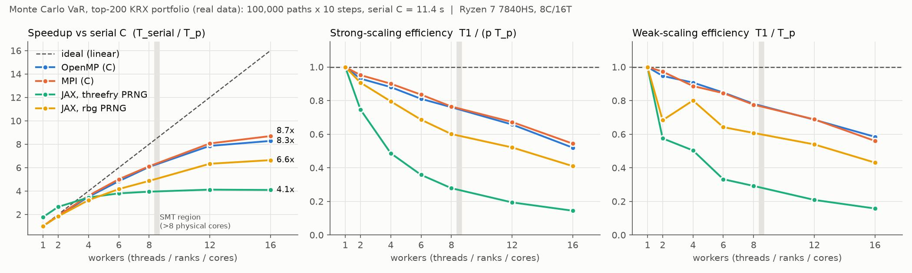

# Parallel Monte Carlo Risk Engine

Final project for DCCS 410 Bigdata Distributed Processing System (Korea University).

Estimates the Value-at-Risk of a top-200 KRX stock portfolio (and European option prices) with
correlated geometric Brownian motion fitted to every listed Korean stock, and measures the speedup
from OpenMP, MPI and JAX.

Final report: [report/FINAL_REPORT.md](report/FINAL_REPORT.md) ([PDF](report/FINAL_REPORT.pdf)).

## Pipeline

1. `ingest/`: daily prices of every KRX-listed stock (KOSPI, KOSDAQ, KONEX) from the data.go.kr
   OpenAPI (금융위원회_주식시세정보 V2), one request per trading day, gzip cache and SHA-256 manifest.
   **2,646,624 rows, 3,176 stocks, 937 trading days (2023-01-02 to 2026-11-05).**
2. `spark/`: log returns for the whole market, corporate-action cleaning (share count changed by
   more than 10 %, or a move outside the KRX ±30 % daily limit), per-stock statistics, and the
   200 x 200 covariance of the top-200 stocks by market cap via a distributed self-join on date
   (17.4 M pair rows, 865 aligned days). About 22 s on `local[*]`.
3. `sim/`: serial, OpenMP and MPI simulators in C, plus NumPy and JAX versions; `validate.py`
   checks them.
4. `bench/`: strong/weak scaling (`scaling.py`) and the cross-implementation comparison (`compare.py`).
5. `results/`: benchmark tables and figures.

## Results (real data)

10-day VaR of 100 M KRW equally weighted over the top-200 stocks (1,000,000 paths x 10 steps,
OpenMP 16 threads, 13.4 s; `results/var_top200_real.json`):

| VaR95 | CVaR95 | VaR99 | CVaR99 |
| --- | --- | --- | --- |
| 6.50 M KRW (6.50 %) | 8.42 M KRW (8.42 %) | 9.64 M KRW (9.64 %) | 11.13 M KRW (11.13 %) |

Scaling, Ryzen 7 7840HS (8 cores / 16 hardware threads), 7.5 GB RAM under WSL2:



Real data, top-200 portfolio, 100,000 paths x 10 steps (strong) / 10,000 paths per worker (weak);
median of 3 runs. Serial C baseline: 11.38 s.

| Implementation | 1 worker | 8 workers | 16 workers | Speedup vs serial C (8 / 16) | Strong eff. (8 / 16) | Weak eff. (8 / 16) |
| --- | --- | --- | --- | --- | --- | --- |
| OpenMP (C) | 11.44 s | 1.88 s | 1.37 s | 6.1x / 8.3x | 0.76 / 0.52 | 0.78 / 0.58 |
| MPI (C) | 11.39 s | 1.86 s | 1.31 s | 6.1x / 8.7x | 0.76 / 0.54 | 0.78 / 0.56 |
| JAX, threefry PRNG | 6.43 s | 2.89 s | 2.78 s | 3.9x / 4.1x | 0.28 / 0.14 | 0.29 / 0.16 |
| JAX, rbg PRNG | 11.25 s | 2.34 s | 1.71 s | 4.9x / 6.6x | 0.60 / 0.41 | 0.61 / 0.43 |

Observations:

- **OpenMP and MPI scale almost identically.** MPI communication (Bcast of the model, one Reduce,
  Gatherv of the losses for the quantile) takes under 1 % of wall time, so the path loop dominates.
- **Efficiency falls even in weak scaling**, where the paths are fully independent. This points to
  the hardware rather than to synchronisation: beyond 8 workers two threads share one physical core
  (SMT), and at 16 MPI ranks the slowest rank takes about 16 % longer than the fastest. The laptop's
  boost clock probably also drops as more cores load up, but that was not measured.
- **JAX is fastest on one core** (6.4 s, 1.8x the serial C code), because it turns the per-path
  triangular mat-vec into one dense (chunk x 200) @ (200 x 200) GEMM per step.
- **JAX with the default threefry PRNG stops at about 4x.** Profiling one step shows that normal
  generation takes about 80 % of the time and speeds up only 1.8x on 16 cores (the GEMM speeds up
  5.6x): an Amdahl's-law limit. Switching to the `rbg` PRNG makes one core 1.6x slower, but random
  generation scales about 7x, so 16 cores reach 6.6x.

Per-implementation plots: `results/{omp,mpi,jax,jax_rbg}_scaling.png`.

## Setup

```bash
python -m venv .venv && source .venv/bin/activate
pip install -r requirements.txt
cp .env.example .env   # then add your data.go.kr API key (금융위원회_주식시세정보)
sudo apt install libopenmpi-dev openmpi-bin   # MPI toolchain for build/mc_mpi
```

## Running

```bash
python ingest/fetch_prices.py          # real data (needs key); --synthetic for an offline factor-model market
python spark/stats.py                  # returns, mu, sigma, top-200 covariance -> data/stats/
make -C sim                            # build/mc_serial, build/mc_omp, build/mc_mpi
python sim/validate.py                 # 18 correctness checks
python bench/scaling.py --impl omp     # also: mpi, jax, jax_rbg  -> results/<impl>_*
python bench/compare.py                # results/compare.png, results/summary.md
```

Simulator CLI (the C implementations share it; `sim/mc_jax.py` takes the same VaR options):

```bash
./build/mc_omp --mode var --paths 1000000 --steps 10 --T 0.0397 --value 1e8   # 10-day VaR/CVaR
mpirun -np 8 ./build/mc_mpi --paths 1000000
./build/mc_serial --mode option --paths 1000000 --steps 52 --T 1 --r 0.03 --K 1.0
python sim/mc_jax.py --paths 1000000 --prng rbg
```

Path `p` always draws from RNG stream `(seed, p)`, so serial, OpenMP and MPI runs simulate exactly
the same paths, and parallel VaR results are bit-identical to serial. `validate.py` checks this along
with Black–Scholes prices, a closed-form single-asset VaR, and agreement with the independent NumPy
and JAX implementations.

## Timeline

| Date | Milestone | State |
| --- | --- | --- |
| Nov 4 | Project skeleton | done |
| Nov 7 (planned) / Nov 8 | Ingestion, Spark statistics, serial simulator validated against Black–Scholes | done |
| Nov 8 | Scope extended from 8 stocks to the full KRX universe (top-200 portfolio); OpenMP and MPI versions | done |
| Nov 8 | JAX version | done |
| Nov 9 | Real-data run (API moved to a V2 endpoint); benchmarks of all implementations on real data | done |
| Dec 8 | Presentation | |
| Dec 16 | Final report | |
