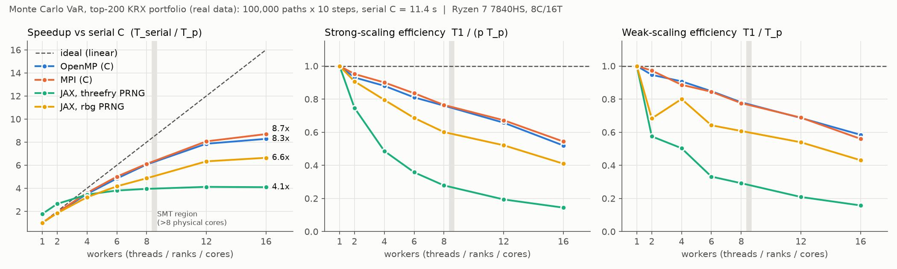

# Parallel Monte Carlo Risk Engine

**DCCS 410 Bigdata Distributed Processing System — Final Project Report**

**Student name:** [Student name] ([Student ID])

**Source code and results:** <https://github.com/JBR-313/parallel-mc-risk-engine>

---

## 1. Project objectives

The project estimates how much a Korean stock portfolio could lose over the next two weeks, using
the market data of every listed Korean stock and parallel computing.

1. **Collect big data from a public OpenAPI.** Download the daily prices of every stock listed on
   the Korea Exchange (KOSPI, KOSDAQ, KONEX) for almost four years from the data.go.kr OpenAPI, in a
   reproducible way.
2. **Process it with a distributed engine.** Use Apache Spark to turn the raw prices into daily
   returns, clean them, compute statistics for every stock, and build the 200 × 200 covariance
   matrix of the 200 largest stocks.
3. **Simulate risk at scale.** Use the covariance matrix in a Monte Carlo model (correlated
   geometric Brownian motion) to simulate one million ten-day futures of the portfolio, and read
   its Value-at-Risk (VaR) and Conditional VaR (CVaR).
4. **Parallelize and measure.** Implement the simulator in serial C, OpenMP, MPI and JAX, check
   that they agree, and measure speedup and strong and weak scaling.

## 2. Project summary

### 2.1 Data and pipeline

| Stage | Tool | What it does | Size |
| --- | --- | --- | --- |
| 1. Ingest | Python, data.go.kr OpenAPI (Financial Services Commission stock price service, V2) | One request per trading day returns every listed stock; 4 threads; responses cached (gzip) with a SHA-256 manifest; output Parquet partitioned by year | 2,646,624 rows, 3,176 stocks, 937 trading days (2023-01-02 to 2026-11-05) |
| 2. Statistics | Apache Spark (PySpark, `local[*]`) | Log returns with a window function (`lag` over date); removal of corporate-action returns; mean and volatility for every stock | 2,643,448 returns; 2,876 stocks described |
| 3. Covariance | Apache Spark | Top 200 stocks by market cap; self-join of the returns on date for every pair i ≤ j, then `groupBy(i, j)` sums | 17,386,500 pair rows → one 200 × 200 matrix, 865 aligned days |
| 4. Simulation | C (serial, OpenMP, MPI), JAX | Correlated GBM, 10 daily steps, equally weighted 100 M KRW portfolio | 1,000,000 paths; about 2 × 10¹¹ multiply-adds per run |

The endpoint is `apis.data.go.kr/1160100/GetStockSecuritiesInfoService_V2/getStockPriceInfo_V2`.
Stages 2 and 3 together take 22 seconds on a laptop. Re-running stage 1 from the cache rebuilds
exactly the same data in 31 seconds with no network requests, which the SHA-256 manifest verifies.

**Cleaning.** The API gives unadjusted prices, so a stock split looks like a crash. A daily
return is removed when the number of listed shares changed by more than 10 % that day (split,
bonus issue, large rights offering) or when it lies outside the Korea Exchange's ±30 % daily price
limit, which no real price move can do. This removed 2,000 and 597 returns respectively.

**Covariance.** The matrix is computed as a distributed self-join rather than by collecting the
data to one machine. Only dates on which all 200 stocks have a clean return are used, so the
result is a proper sample covariance (positive definite, condition number about 4,600). The Spark
result is checked against NumPy on every run (agreement to 10⁻⁸ relative).

### 2.2 Parallel simulation

Each simulated path `p` draws its random numbers from its own stream, seeded by `(seed, p)`. A
path therefore gives the same numbers whichever thread or process computes it, so a parallel run
must reproduce the serial run exactly. This made the parallel versions testable.

- **OpenMP:** paths are split statically over threads; each thread keeps a private accumulator,
  merged once at the end.
- **MPI:** rank 0 reads the model and broadcasts it (`MPI_Bcast`); each rank simulates a block of
  paths; sums are combined with `MPI_Reduce` and the per-path losses are collected with
  `MPI_Gatherv`, because a quantile needs the whole distribution.
- **JAX:** a `jit`-compiled function processes chunks of paths; each time step is one dense
  (chunk × 200) @ (200 × 200) matrix product, executed by XLA's multithreaded CPU backend.

**Correctness.** `sim/validate.py` runs 18 checks, all passing on the real data: European option
prices within 1.4 standard errors of the Black–Scholes formula; a single-asset VaR within 0.1 % of
its closed form; OpenMP (2, 7, 16 threads) and MPI (2, 3, 8 ranks) bit-identical to serial;
independent NumPy and JAX implementations within 0.7 % of the C result for VaR99.

### 2.3 Results

**Risk.** For 100 M KRW spread equally over the 200 largest stocks, as of 2026-11-05
(1,000,000 paths, 13.4 s on 16 OpenMP threads):

| Horizon: 10 trading days | VaR 95 % | CVaR 95 % | VaR 99 % | CVaR 99 % |
| --- | --- | --- | --- | --- |
| Loss (KRW) | 6.50 M | 8.42 M | 9.64 M | 11.13 M |
| Share of portfolio | 6.50 % | 8.42 % | 9.64 % | 11.13 % |

With 99 % probability the portfolio loses no more than 9.64 % in ten trading days; in the worst
1 % of cases the average loss is 11.13 %.

**Speedup.** AMD Ryzen 7 7840HS (8 cores, 16 hardware threads), 7.5 GB RAM, WSL2. Strong scaling
uses 100,000 paths × 10 steps; weak scaling uses 10,000 paths per worker; each point is the median
of three runs. The serial C baseline takes 11.38 s.



| Implementation | 1 worker | 8 workers | 16 workers | Speedup vs serial C (8 / 16) | Strong efficiency (8 / 16) | Weak efficiency (8 / 16) |
| --- | --- | --- | --- | --- | --- | --- |
| OpenMP (C) | 11.44 s | 1.88 s | 1.37 s | 6.1× / 8.3× | 0.76 / 0.52 | 0.78 / 0.58 |
| MPI (C) | 11.39 s | 1.86 s | 1.31 s | 6.1× / 8.7× | 0.76 / 0.54 | 0.78 / 0.56 |
| JAX, threefry PRNG | 6.43 s | 2.89 s | 2.78 s | 3.9× / 4.1× | 0.28 / 0.14 | 0.29 / 0.16 |
| JAX, rbg PRNG | 11.25 s | 2.34 s | 1.71 s | 4.9× / 6.6× | 0.60 / 0.41 | 0.61 / 0.43 |

Findings:

- **OpenMP and MPI scale almost the same.** MPI communication takes under 1 % of the wall time,
  because the paths are independent and only the final losses are gathered.
- **Efficiency falls even in weak scaling**, where no worker waits for another. The likely cause is
  the hardware rather than synchronization: beyond 8 workers two threads share one physical core
  (SMT), and at 16 MPI ranks the slowest rank took about 16 % longer than the fastest. A drop of the
  laptop's boost clock under load may also contribute; it was not measured.
- **JAX is the fastest on one core** (6.4 s against 11.4 s for serial C). Expressing each step as one
  dense matrix product lets the optimized linear-algebra kernel do the work that the C code does
  path by path.
- **JAX with the default threefry PRNG stops at about 4×.** Profiling one step showed that
  normal-random-number generation takes about 80 % of the time and speeds up only 1.8× on 16 cores,
  while the matrix product speeds up 5.6×. This is Amdahl's law. The `rbg` generator is 1.6× slower
  on one core but its generation scales about 7×, so JAX reaches 6.6× on 16 cores.

### 2.4 Challenges and how they were solved

| Problem | Cause | Solution | Result |
| --- | --- | --- | --- |
| The approved API key was rejected for more than a day ("SERVICE_KEY_IS_NOT_REGISTERED") | The service had moved to a V2 endpoint; the old path rejects V2 keys | Compared the request URL with the operation in the portal's specification | Real data collected |
| The editor (VSCode) crashed with an out-of-memory kill | After moving from 8 to 200 assets, the NumPy reference allocated an 8 GB array on a 7.5 GB machine | Process paths in chunks sized to a 64 MB budget, one time step at a time | Peak memory 142 MB |
| Ingestion peaked at 4.6 GB | Finished thread-pool futures kept every day's raw JSON until the end | Convert each day to a compact table inside the worker and drop each future once read | Peak memory 1.3 GB |
| Only 371 of 937 days could be used for the covariance | Every change in share count (including small convertible-bond conversions) was treated as a split, and one such stock removed the whole date | Flag a corporate action only when shares change by more than 10 % | 865 usable days |
| Spark could not read the Parquet files | pandas wrote nanosecond timestamps, which Spark rejects | Store dates as a `date` type | Fixed |
| JAX stopped scaling near 4× | Random-number generation dominated and parallelized poorly | Profiled the step; added the `rbg` generator as an option | 4.1× → 6.6× on 16 cores |

### 2.5 Reproducing the results

```bash
pip install -r requirements.txt
sudo apt install libopenmpi-dev openmpi-bin
cp .env.example .env                 # add a data.go.kr key for the FSC stock price service
python ingest/fetch_prices.py        # or --synthetic for offline test data
python spark/stats.py
make -C sim
python sim/validate.py               # 18 checks
python bench/scaling.py --impl omp   # also mpi, jax, jax_rbg
python bench/compare.py              # results/compare.png and results/summary.md
```

All benchmark tables and figures are in the `results/` folder of the repository.

## 3. Project timeline (actual)

| Date | Planned milestone | What was actually done |
| --- | --- | --- |
| Oct 21 | Proposal (due) | One-page proposal; its milestones are the "Planned milestone" column of this table |
| Nov 4 | — | Repository skeleton and plan |
| Nov 7 | OpenAPI ingestion, Spark statistics, serial simulator validated against Black–Scholes | Done on Nov 8, one day late, first on synthetic data because no working API key was available yet |
| Nov 8 | — | Scope extended from 8 stocks to the whole Korean market (top-200 portfolio) so that the data volume justifies Spark; OpenMP and MPI versions written and validated |
| Nov 14 (planned) | OpenMP version and benchmarks | Done early, on Nov 8 |
| Nov 21 (planned) | MPI version and benchmarks | Done early, on Nov 8 |
| Nov 8 | — | JAX version (planned for Dec 5) written and validated |
| Nov 9 | — | API problem traced to the V2 endpoint; full real-data run (2.6 M rows); all implementations benchmarked on real data; `rbg` PRNG added after profiling JAX |
| Nov 18 | — | Work merged into the main branch on GitHub |
| Nov 22 | Slides (planned Dec 5) | Presentation slides prepared |
| Dec 8 | Presentation | 5-minute talk in class (slides ready since Nov 22) |
| Dec 16 | Final report | This report |

Compared with the plan, the parallel implementations finished about two weeks early. The main delay
was the real-data run, which waited a day on the API problem; the pipeline was meanwhile developed
and tested on a synthetic market with the same schema.

## 4. Conclusion

The project handled 2.6 million rows of real market data through a public OpenAPI and Apache
Spark, and used the result in a Monte Carlo risk model that runs 8.3–8.7 times faster with OpenMP
and MPI on one 8-core laptop. Three lessons stand out. First, a distributed join and aggregation
turned a market-wide covariance into a 22-second job. Second, giving every path a fixed random
stream made parallel results exactly checkable against serial ones. Third, profiling mattered
more than adding cores: the JAX version showed that rewriting the computation as a matrix product
helps on one core, and that a single poorly parallel part (random-number generation) limits the
whole program.
